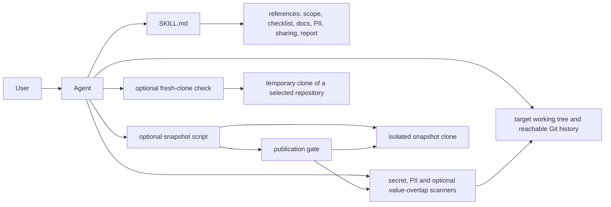

# github-ready

Agent playbook that prepares a local repository for a public or private GitHub
remote, including sharing with a bot or reviewer.

Scanners find candidates; the agent reads the tree and reviews context. It
fixes proven privacy and git hygiene issues, removes provable debris, aligns
docs with the code, runs available project checks, and reports whether any
blocking publication concern remains. It preserves legitimate attribution.
It does not push or rewrite history without the user's named approval this
turn; approved snapshot publication pushes only from an isolated clone.
A clean scan does not prove absence of PII.

## Why it exists

"Clean this up before I put it on GitHub" is a long, easy-to-skimp
pass: secrets in fixtures, `/home/<account>` in scripts, a README that
names deleted commands, an extra `temp.py` at the root. This skill
makes that pass one load instead of a pasted essay.

## When to load it

User says prepare for GitHub, make this repo public, clean up my repo
before I push it to GitHub, share it with a bot, public release prep,
sanitize the repo, GitHub readiness,
`/github-ready`, or `/repo-publish-prep`.

Not for routine code-quality cleanup, a secret-only scan, or an
architecture study. Those are other skills.

## Architecture

The agent orchestrates the review: `SKILL.md` defines the phases and rules,
and the references provide phase-specific guidance. The scanners are local
command-line tools that return findings for contextual review; they do not
decide what is safe to share. The snapshot and fresh-clone paths are optional.



The tools run locally and use no external APIs. An approved snapshot leaves
a persistent isolated clone. Network verification and pushes need the user's
explicit request or named approval.

The snapshot script creates a parentless commit from the source's committed
tree, optionally excludes paths, and checks a separate clone. Its gate combines
the scanners with commit-count, ref and author/committer checks. A private
source's history is not included in that clone. The fresh-clone check runs
specified commands in a scrubbed environment; it is not a filesystem sandbox.

## Personal and shareable material

The intended shareable source is the tracked skill, references, scripts and
synthetic tests. Examples describe privacy checks and use placeholders, not
real review subjects. Keep identity allow/deny lists, private source data,
review notes, generated reports, credentials and machine-specific settings
outside the repository. For local convenience, `.private/` is ignored. Store
identity policies outside both source and publication repositories; the value
overlap scanner requires its private sources outside the target repository.

An ignore rule does not protect already tracked files or erase Git history.
Review the exact tree and reachable history before any push, even to a private
remote: everyone granted access can read them. Reassess the boundary and
identity policy before any public release. Scanner results are candidates, not
a guarantee that personal information or secrets are absent.

## Layout

```
SKILL.md                  # when, modes, ordered phases, hard rules
references/checklist.md   # secrets, privacy, gitignore, dead code, deps
references/docs.md        # README + architecture + examples
references/report.md      # final report and readiness checklist
references/publication-scope.md  # what gets published, exact-output checks
references/pii-review.md  # identities, and values copied from private data
references/snapshot-and-sharing.md  # one-commit snapshot, fresh clone, bot access
scripts/safe_repo_scan.py # metadata-only secrets/history/diff scan
scripts/pii_scan.py       # metadata-only PII candidates
scripts/value_overlap_scan.py  # private numbers found in tracked files, lines only
scripts/publish_gate.py   # aggregate pattern and repository policy gate
scripts/publish_snapshot.sh  # replace-style snapshot; prints isolated-clone push
scripts/fresh_clone_check.py # scrubbed environment, commands, watched metadata
scripts/test_safe_repo_scan.py
scripts/test_pii_scan.py
scripts/test_value_overlap_scan.py
scripts/test_publish_gate.py
scripts/test_publish_snapshot.py
scripts/test_fresh_clone_check.py
scripts/test_end_to_end.py
```

## Requirements

An agent that can read the tree, search, edit, and run local commands,
plus Git, Python 3.10 or newer and Bash for the bundled tools. No extra packages.
Local preparation needs no network.

## Test

From this skill folder, run the offline suite:

```bash
python3 -m unittest discover -s scripts -p 'test_*.py'
```

## Typical workflow

1. Load `SKILL.md`.
2. Default mode **prepare** mutates the working tree after an audit
   list exists. It removes provable slop without asking about each
   obvious item and leaves ambiguous candidates for the report. Pass
   `audit` (or say "audit only") to run every check and produce the same
   evidence-rich report without editing files.
3. Run phases 0–6 in order, starting by protecting pre-existing user work.
   Open each `references/` file only when that phase starts.
4. Emit the report. Commit only if asked. Build a snapshot or push only with
   the user's named approval this turn; push from the isolated clone.

## License

[MIT](LICENSE).
