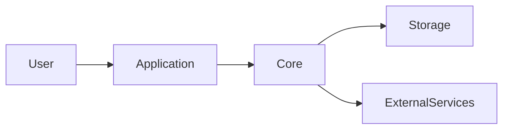

# Docs

Load during SKILL.md phase 4. Inspect all documentation in either mode.
In audit mode, report needed changes without making them. In prepare
mode, write from the implementation. Do not invent features, commands,
env vars, or components.

## What to read

Every project markdown file, not only `README.md`: `/docs`, setup
guides, architecture notes, examples, config docs, TODO dumps, design
docs, and usage text inside scripts.

Compare each claim to disk. Fix:

- stale instructions, renamed commands, deleted files still named
- old architecture, obsolete config, contradictory statements
- dead links, outdated examples, mixed terms for the same thing

When two documents conflict, pick one authority and point the other at
it or delete the provably stale one. In prepare mode, remove empty
templates, abandoned TODO dumps, duplicate generated docs, placeholder
copy, and other documentation slop when the tree proves it has no live
purpose. Do not preserve obvious debris merely because deletion is a
change. Report genuinely ambiguous material instead. Keep historical
notes only if they still explain a decision a new developer needs.

## README

Root `README.md` is the first thing a stranger reads. Fix it in place
from the implementation; create it only if missing. Never replace a
working README with this template — fill the gaps that actually exist.
Use sentence-case headings. Include only sections that apply.

```markdown
# <project name>

One sentence: what it does.

## Why it exists

The problem it solves.

## Features

Short list of major capabilities that exist in the tree.

## Architecture

A few sentences plus the Mermaid diagram (or a link to
`docs/architecture.md` if that file carries the detail).

## Repository structure

The directories a new developer must understand. Skip generated trees.

## Requirements

Runtime, tooling, prerequisites.

## Installation

Exact commands that work from a clean checkout.

## Configuration

| Variable | Required | Description |
|----------|----------|-------------|

Never put a real secret here. Explain how to provide each required value;
link an `.env.example` only when one is included in the public artifact.

## Running locally

The one canonical command.

## Tests

How to run them.

## Development

Lint, format, typecheck, other day-to-day commands. Omit if none.

## Typical workflow

How someone actually uses it.

## Limitations

Only if they are real.

## Contributing

Only if the project wants external contributors.

## License

The license file, or "No license selected yet."
```

## Architecture

Keep architecture detail in the README. Create `docs/architecture.md`
only when the README cannot hold it — a large multi-service system,
not a normal app.

Explain, from the code:

- entry points
- major modules
- data flow
- storage
- external APIs
- important boundaries
- configuration
- generated outputs

GitHub-flavored Mermaid, matching reality:



Replace those nodes with the real ones. Do not add boxes for tools the
repo does not use.

A separate file always needs a reason; the README diagram is the
default.

## Examples

Safe, obviously fake, matching the current API and config. Use an
`.env.example` only when it materially improves onboarding and belongs in
the public scope; clear prose or a neutral config template may be better.

Do not include real credentials, unintended private identity data, or
machine paths. Preserve legitimate authorship, copyright, citations,
and contributor attribution.

## Publication scope

Inspect every doc to catch stale or private material, then decide whether
external users or contributors need it. ADRs, issue trackers, backlogs,
context notes, changelogs, agent instructions, and local setup records are
not automatically public just because they are useful during development.
Keep valuable development history in the source repo; exclude it from a
curated public snapshot when it does not support the public product or
contribution workflow. Do not delete source files solely to make an export
smaller.

Check kept docs for local commit IDs or links, machine-specific paths,
internal issue references, host-specific commands, usernames, and
development-only workflows. Remove stale links to excluded material from
the public README, skill instructions, runtime errors, and tests.
